# Raj Aryan

<h3><code>rajaryan@github ~ $ ./contributions.sh</code></h3>

  

<h3><code>rajaryan@github ~ $ whoami</code></h3>
<table>
  <tr>
    <td valign="top"></td>
    <td valign="top"></td>
  </tr>
</table>

---

<h3><code>rajaryan@github ~ $ cat ./featured-projects.md</code></h3>

## 🚀 Featured Projects

### 🥇 [AI Career Agent](https://github.com/rajaryan1111/ai-career-agent)
A local-first desktop application for structured job tracking and explainable career decisions.

- Manual job entry and application tracking
- Conservative eligibility checks and explainable skill overlap
- **Status:** Active desktop alpha. Live job discovery, automated resume parsing, form filling, and application submission are not implemented yet.

**Stack:** `Python` · `SQLite` · `Desktop UI` · `Testing`

### 🧠 [IS Copilot — Indian Standards & Procurement AI](https://github.com/rajaryan1111/indian-standards-procurement-ai)
AI-assisted discovery of potentially applicable Indian Standards, semantic retrieval, evidence-backed recommendations, and specification-gap analysis.

**Stack:** `React` · `TypeScript` · [Live demo](https://indian-standards-procurement-ai.vercel.app/)

### 🤖 [Jarvis / ULTRON — AI Voice Assistant](https://github.com/rajaryan1111/jarvis-assistant)
A macOS-focused voice assistant exploring LLM tools, local knowledge retrieval, optional vision, and computer automation with confirmation boundaries.

**Stack:** `Python` · `LLM tools` · `Voice` · `Computer vision`

### 🦺 [H₂S Exposure Dosimeter](https://github.com/rajaryan1111/SIH-H2S-Dosimeter)
Hackathon project exploring a colorimetric hydrogen-sulfide exposure-dosimeter workflow with AI-assisted quantitative reading.

### 🔗 [GraphOne Intelligence Pipeline](https://github.com/rajaryan1111/graphone-intelligence-pipeline)
Data-intelligence pipeline focused on provenance, validation, and explicit failure accounting.

### 🪪 [Fake-ID Screening](https://github.com/rajaryan1111/fake-id-screening)
Document-image screening prototype with OCR/image-analysis components, API validation, and a mobile capture workflow. Human review is required; it is not authoritative identity verification.

---

<h3><code>rajaryan@github ~ $ neofetch</code></h3>

- 🎓 B.Tech — Electronics and Communication Engineering
- 🧠 Focus: AI/ML, agentic workflows, RAG, LLM applications, and computer vision
- 🛠️ Languages & tools: Python, TypeScript, JavaScript, SQL, React, FastAPI, PostgreSQL, Docker
- 💼 Interested in AI/ML internships, open-source projects, and collaborations
- 🔗 [LinkedIn](https://www.linkedin.com/in/raj-aryan-20aa32394/) · [Portfolio](https://github.com/rajaryan1111/raj-aryan-portfolio)

---

<h3><code>rajaryan@github ~ $ ./profile-status.sh</code></h3>

**Build philosophy:** useful features, evidence-backed outputs, tests, safe defaults, and honest project status.

*The portrait and info card animate once and freeze. The contribution heatmap is generated from GitHub's public contribution calendar and refreshed daily by GitHub Actions. All animation lives inside committed SVGs; no JavaScript or third-party stats service is used.*
