# Raj Aryan

### AI/ML Engineer in progress · Agentic AI · LLM Applications · RAG

I build AI systems that connect language models, retrieval, automation, and software engineering to solve practical problems. I care about the part beyond the demo: clear system boundaries, testable behavior, evidence, and honest reporting of what works.

  

  <a href="https://github.com/rajaryan1111/ai-career-agent"><strong>🚀 Flagship project: AI Career Agent</strong></a>
  &nbsp;·&nbsp;
  <a href="https://github.com/rajaryan1111">GitHub</a>
  &nbsp;·&nbsp;
  <a href="https://www.linkedin.com/in/raj-aryan-20aa32394/">LinkedIn</a>
  &nbsp;·&nbsp;
  <a href="https://github.com/rajaryan1111/raj-aryan-portfolio">Portfolio</a>

- 🎓 B.Tech — Electronics and Communication Engineering
- 📍 Bengaluru, India
- 🎯 Focus: AI engineering, agentic workflows, RAG, LLM applications, and practical ML
- 💼 Open to AI/ML internships, research-oriented projects, and collaborations

---

## 🚀 Flagship project — AI Career Agent

**[AI Career Agent →](https://github.com/rajaryan1111/ai-career-agent)**

A local-first desktop application aimed at making a job search more structured, explainable, and trackable—not a black-box auto-apply bot.

| Workflow | Current scope |
|---|---|
| Job tracking | Add and manage job opportunities manually |
| Eligibility checks | Conservative, explicit eligibility states rather than unsupported assumptions |
| Skill overlap | Explainable comparison between job requirements and candidate skills |
| Shortlisting | Help organize opportunities for review |
| Application tracking | Keep a local record of application progress |

**Current stage:** desktop alpha / active development. Live job discovery, automated resume parsing, form filling, messaging, and application submission are **not currently implemented**. External actions should remain behind explicit authorization and quality gates. See the repository README for setup, acceptance criteria, and the latest implementation status.

---

## Selected projects

<table>
  <tr>
    <td width="50%" valign="top">
      <h3><a href="https://github.com/rajaryan1111/indian-standards-procurement-ai">IS Copilot</a></h3>
      AI-assisted discovery of potentially applicable Indian Standards, with semantic retrieval, explainable recommendations, evidence, relationship expansion, and specification-gap analysis.
        
      <strong>Stack:</strong> React · TypeScript
       
      <a href="https://indian-standards-procurement-ai.vercel.app/">Live demo</a> · Repository README documents 53 passing tests.
    </td>
    <td width="50%" valign="top">
      <h3><a href="https://github.com/rajaryan1111/jarvis-assistant">Jarvis / ULTRON</a></h3>
      A macOS-focused voice assistant exploring LLM tools, local knowledge retrieval, optional vision, and computer automation with confirmation boundaries.
        
      <strong>Stack:</strong> Python
       
      Modular optional dependencies, tests, and CI.
    </td>
  </tr>
  <tr>
    <td width="50%" valign="top">
      <h3><a href="https://github.com/rajaryan1111/SIH-H2S-Dosimeter">H₂S Exposure Dosimeter</a></h3>
      Hackathon project exploring a colorimetric hydrogen-sulfide exposure-dosimeter workflow with AI-assisted quantitative reading.
        
      <strong>Focus:</strong> Hardware-adjacent ML · Computer vision
    </td>
    <td width="50%" valign="top">
      <h3><a href="https://github.com/rajaryan1111/graphone-intelligence-pipeline">GraphOne Intelligence Pipeline</a></h3>
      Data-intelligence pipeline focused on provenance, validation, and explicit failure accounting.
        
      <strong>Stack:</strong> Python · Docker
       
      Active development; default branch is `phase-8-repair`.
    </td>
  </tr>
  <tr>
    <td width="50%" valign="top">
      <h3><a href="https://github.com/rajaryan1111/fake-id-screening">Fake-ID Screening</a></h3>
      Prototype for document-image screening with OCR/image-analysis components, API validation, and a mobile capture workflow.
        
      <strong>Stack:</strong> FastAPI · PostgreSQL/Supabase
       
      Human review is required; this is not authoritative identity verification.
    </td>
    <td width="50%" valign="top">
      <h3>What I optimize for</h3>
      <ul>
        <li>Evidence-backed AI outputs</li>
        <li>Tests for important behavior and failure cases</li>
        <li>Safe defaults and explicit authorization for sensitive actions</li>
        <li>Reproducible setup and honest implementation status</li>
      </ul>
    </td>
  </tr>
</table>

---

## Technical toolkit

- **Languages:** Python, TypeScript, JavaScript, SQL
- **AI / ML:** LLM applications, RAG, embeddings, agentic workflows, computer vision, OCR
- **Backend / data:** FastAPI, Node.js, PostgreSQL, SQLAlchemy
- **Frontend:** React, Vite, Tailwind CSS, React Flow, Recharts
- **Engineering:** Git, GitHub Actions, Docker, testing, deployment

I list these as technologies I work with, not as a claim of equal proficiency across every tool.

## Current engineering focus

- Making AI Career Agent's local workflows, eligibility states, and application tracking reliable and testable.
- Strengthening IS Copilot's analysis pipeline, explainability, and regression coverage.
- Hardening Jarvis integrations with safer configuration and failure handling.

## Current learning focus

Agentic AI, RAG evaluation, LLM application engineering, retrieval quality, and production-oriented ML workflows.

---

*Building reliable AI systems, one measurable improvement at a time.*
